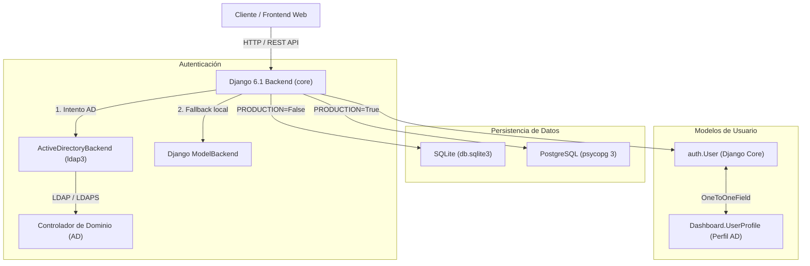
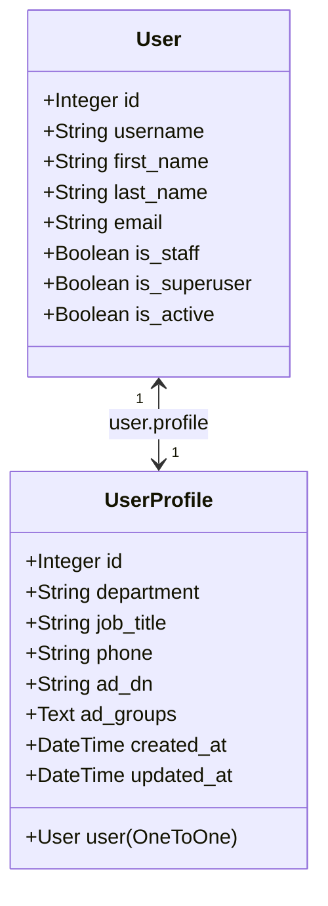

# Arquitectura del Sistema - Gestión Comercial

Este documento describe la arquitectura técnica, los componentes clave, los flujos de autenticación y la estrategia de base de datos del backend de **Gestión Comercial**.

---

## 1. Visión General de la Arquitectura

El sistema está construido sobre **Django 6.1** y estructurado para entornos desacoplados (Backend API REST + Frontend), con soporte híbrido de base de datos y autenticación corporativa contra **Active Directory (AD / LDAP)**.



---

## 2. Pila Tecnológica (Tech Stack)

| Componente | Tecnología | Versión | Propósito |
| :--- | :--- | :--- | :--- |
| **Framework Web** | Django | 6.1.1 | Núcleo del backend y ORM |
| **Gestión de Entornos** | django-environ | 0.14.0 | Carga de variables tipadas desde `.env` |
| **Directorio Activo / LDAP** | ldap3 | 2.9.1 | Conexión 100% pura Python con Active Directory |
| **Driver PostgreSQL** | psycopg (binary) | 3.3.6 | Driver moderno de alta velocidad para producción |
| **Base de Datos Local** | SQLite | 3.x | Base de datos ligera para desarrollo rápido |
| **Base de Datos Producción** | PostgreSQL | 14+ | Motor relacional robusto con connection pooling |

---

## 3. Estrategia Dinámica de Base de Datos

El sistema conmuta de forma automática entre motores según la variable de entorno `PRODUCTION`:

```python
if PRODUCTION:
    # Producción: PostgreSQL con connection pooling
    DATABASES['default'] = env.db('DATABASE_URL', default=default_postgres_url)
    DATABASES['default']['CONN_MAX_AGE'] = env.int('DB_CONN_MAX_AGE', default=600)
else:
    # Desarrollo: SQLite local
    DATABASES['default'] = {
        'ENGINE': 'django.db.backends.sqlite3',
        'NAME': BASE_DIR / 'db.sqlite3',
    }
```

- **Desarrollo (`PRODUCTION=False`):** No requiere instalar ni levantar un servidor de base de datos; crea `db.sqlite3` en `backend/`.
- **Producción (`PRODUCTION=True`):** Se conecta a PostgreSQL mediante `DATABASE_URL` o parámetros individuales (`DB_NAME`, `DB_USER`, `DB_PASSWORD`, `DB_HOST`, `DB_PORT`). Conexiones persistentes activas (`CONN_MAX_AGE=600`).

---

## 4. Ciclo de Vida de Usuario y Perfil (`UserProfile`)

Para cumplir con el requerimiento de sincronización corporativa, cada usuario tiene asociado un perfil extendido en la app `Dashboard`:



### Automatizaciones:
1. **Señal `post_save`:** Cada vez que se crea un `User` (sea por comando, migración o vista), la señal en `Dashboard/signals.py` garantiza que se cree su correspondiente `UserProfile`.
2. **Sincronización AD en inicio de sesión:** Si el usuario proviene de Active Directory, `ActiveDirectoryBackend` extrae sus atributos (`givenName`, `sn`, `mail`, `department`, `title`, `telephoneNumber`, `memberOf`) y actualiza tanto el `User` como el `UserProfile`.
