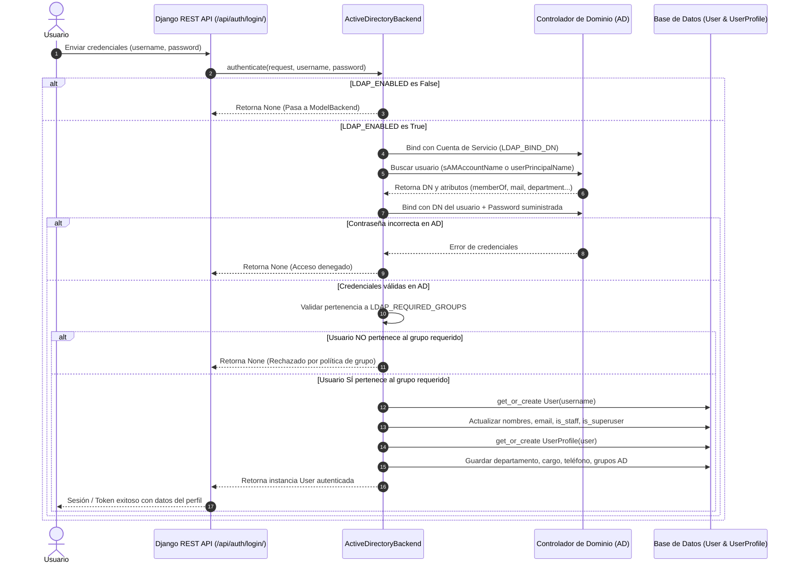

# Manual de Integración con Active Directory (AD / LDAP)

Esta guía explica en detalle cómo opera la autenticación corporativa, el control de acceso basado en grupos de seguridad o GPO, y el aprovisionamiento de perfiles en el sistema.

---

## 1. Flujo de Autenticación Paso a Paso



---

## 2. Variables de Entorno para Active Directory

Todas las variables se configuran en el archivo `.env`:

| Variable | Tipo | Por Defecto | Descripción |
| :--- | :--- | :--- | :--- |
| `LDAP_ENABLED` | Booleano | `False` | Activa o desactiva la conexión con Active Directory. |
| `LDAP_SERVER_URI` | String | `ldap://127.0.0.1:389` | Dirección del Controlador de Dominio (ej. `ldap://192.168.1.10:389` o `ldaps://dc01.empresa.local:636`). |
| `LDAP_PORT` | Entero | `389` | Puerto de conexión (389 para LDAP estándar, 636 para LDAPS seguro). |
| `LDAP_USE_SSL` | Booleano | `False` | `True` si se usa cifrado SSL/TLS directo en el puerto 636. |
| `LDAP_CONNECT_TIMEOUT` | Entero | `5` | Tiempo límite en segundos para responder la conexión antes de fallar. |
| `LDAP_DOMAIN` | String | `""` | Dominio corporativo (ej. `empresa.local` o `CORP`). |
| `LDAP_BIND_DN` | String | `""` | Distinguished Name de la cuenta de servicio (ej. `CN=svc_django,OU=Services,DC=empresa,DC=local`). |
| `LDAP_BIND_PASSWORD` | String | `""` | Contraseña de la cuenta de servicio. |
| `LDAP_SEARCH_BASE` | String | `""` | Base de búsqueda en el árbol de AD (ej. `DC=empresa,DC=local`). |
| `LDAP_REQUIRED_GROUPS` | Lista (comas) | `[]` | Grupos requeridos para iniciar sesión. Si se especifica, el usuario **debe pertenecer** a al menos uno. |
| `LDAP_STAFF_GROUPS` | Lista (comas) | `[]` | Grupos de AD cuyos miembros tendrán `is_staff = True` en Django. |
| `LDAP_SUPERUSER_GROUPS` | Lista (comas) | `[]` | Grupos de AD cuyos miembros tendrán `is_superuser = True` en Django. |

---

## 3. Control de Acceso por GPO y Grupos de Seguridad

En entornos empresariales bajo Active Directory, el acceso a las aplicaciones suele ser gobernado por políticas de grupo (GPO) reflejadas en grupos de seguridad:

1. **Grupo de Acceso Base (`LDAP_REQUIRED_GROUPS`):**
   - Ejemplo: `LDAP_REQUIRED_GROUPS=GestionComercial_Usuarios,GPO_AccesoSistemas`
   - Si un usuario ingresa con usuario y contraseña válidos de AD pero no es miembro de `GestionComercial_Usuarios` ni de `GPO_AccesoSistemas`, el sistema deniega el acceso y genera un log de advertencia:
     ```
     WARNING: AD/LDAP: Acceso DENEGADO. El usuario 'jperez' se autenticó pero no pertenece a los grupos autorizados: ['GestionComercial_Usuarios', 'GPO_AccesoSistemas'].
     ```

2. **Formatos soportados para los grupos:**
   - Nombre simple (CN): `GestionComercial_Usuarios`
   - Distinguished Name completo: `CN=GestionComercial_Usuarios,OU=Grupos,DC=empresa,DC=local`

---

## 4. Requisitos de Red y Firewall

Para que el servidor donde corre Django pueda comunicarse con el Active Directory:

- **Puerto 389 TCP/UDP:** LDAP estándar (si `LDAP_USE_SSL=False`).
- **Puerto 636 TCP:** LDAPS seguro cifrado (si `LDAP_USE_SSL=True`).
- **Puerto 3268 / 3269:** Catálogo Global (Global Catalog) en bosques multidominio (opcional).

---

## 5. Fallback Seguro

En caso de que:
- El Controlador de Dominio esté apagado o inaccesible por red,
- Se produzca un error de timeout,
- O se ingrese con un superusuario local creado manualmente mediante `python manage.py createsuperuser`,

El sistema captura la excepción, registra el incidente en los logs y delega la autenticación automáticamente al `ModelBackend` de Django sin interrumpir la operación del sistema.
